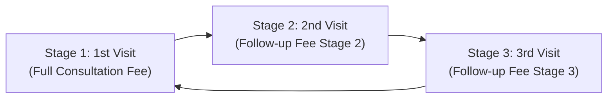

# Green Hospital Clinical & Booking Rules Architecture

This document specifies the authoritative business and clinical scheduling rules implemented in the Green Hospital Doctor Appointment Management System.

---

## 1. Authoritative Timezone (Asia/Dhaka)

All appointment scheduling, booking window calculations, slot generation, serial allocations, and cancellation refund percentages are evaluated strictly against the **Asia/Dhaka** timezone (`UTC+6`).

- `get_dhaka_now()` evaluates authoritative server time in Asia/Dhaka.
- Daylight saving is not observed in Bangladesh; the offset remains fixed at `UTC+6:00`.
- Client-provided local time offsets are disregarded in favor of server-side timezone conversion.

---

## 2. 48-Hour Booking Window Policy

To prevent ghost bookings months in advance while giving patients predictable access to specialists, Green Hospital enforces a strict **48-Hour Booking Window**:

$$\text{Slot Available if: } (\text{appointment\_start} - 48\text{h}) \le \text{now\_dhaka} < \text{appointment\_start}$$

### Boundary Conditions:
- **More than 48 hours before start:** Slot is marked unavailable with reason: `"Booking opens 48h before appointment"`.
- **Exactly 48.0 hours before start:** Slot unlocks and becomes bookable.
- **Between 48 hours and start time:** Slot remains open for patient booking.
- **At or after start time:** Slot is marked unavailable with reason: `"Time slot has passed"`.
- **Walk-in Exception:** Receptionists can bypass the 48-hour forward boundary for in-person same-day walk-in patients (`is_walk_in=True`).

---

## 3. Concurrency-Safe Daily Serial Allocation & Capacity

Serial numbers represent the patient's sequence in the consultation room on the target day.

1. **Doctor-Date Scoping:**
   Serial numbers are strictly monotonically increasing ($1, 2, 3, \dots, N$) scoped to each specific `(doctor, appointment_date)`.
2. **Concurrency Serialization:**
   During booking creation, an exclusive database row lock is acquired on the doctor record:
   ```python
   User.objects.select_for_update().filter(id=doctor.id).first()
   ```
   This prevents race conditions where two concurrent requests could be allocated the identical serial number.
3. **Session & Daily Capacity Enforcement:**
   Each doctor schedule session defines `max_capacity`. If the number of active bookings reaches `max_capacity`, subsequent booking attempts are rejected with `ValidationError("Doctor's maximum capacity for this date has been reached.")`.

---

## 4. 4-Tier Visit Pricing Cycle

Doctor consultation pricing follows a patient-friendly 4-stage recurring cycle in Bangladeshi Taka (BDT):



### Regular Consultation Cycle:
1. **Visit Stage 1 (Initial Consultation):** Charged at `fee_first_visit` (e.g. ৳1,200 BDT).
2. **Visit Stage 2 (First Follow-up):** Charged at `fee_second_visit` (e.g. ৳900 BDT).
3. **Visit Stage 3 (Second Follow-up):** Charged at `fee_third_visit` (e.g. ৳600 BDT).
4. **Visit Stage 4:** Resets back to **Stage 1** (`fee_first_visit`), initiating a fresh cycle.

### Report Check Rule:
- When a patient visits solely for diagnostic report review (`visit_type = REPORT_CHECK`):
  - Charged at `fee_report_check` (e.g. ৳300 BDT).
  - **Does NOT advance the patient's visit stage** (`visit_stage = None`). The patient's subsequent regular visit will remain at their current progression stage.

---

## 5. Strict 24-Hour Cancellation & Refund Policy

Refund calculations are strictly bounded by elapsed time between the cancellation request and the scheduled appointment start time in Asia/Dhaka:

| Cancellation Scenario | Elapsed Time Before Start | Refund Percentage | Policy Code |
|---|---|:---:|---|
| **Patient Timely** | $\ge 24$ hours prior | **100%** | `patient_cancellation_24h_or_more_100_percent` |
| **Patient Boundary** | Exactly $24.00$ hours prior | **100%** | `patient_cancellation_24h_or_more_100_percent` |
| **Patient Late** | $< 24$ hours, but before start | **80%** | `patient_cancellation_under_24h_80_percent` |
| **Patient Post-Start / No-Show** | At or after start time ($\le 0$ sec) | **0%** (Admin Exception Only) | `patient_cancellation_after_start_admin_exception_only` |
| **Doctor / Hospital Cancellation** | Any time | **100%** | `doctor_hospital_cancellation_100_percent` |

### Financial Integrity Controls:
- **Refunds Calculated Only From Real Money Paid:** Unpaid bookings (`payment_status = UNPAID`) produce **0 BDT** refundable amount and generate no payment transactions.
- **Maximum Cap:** A refund can never exceed the net remaining amount (`net_paid_remaining`) of the original payment transaction.
- **Decimal Safety:** All calculations utilize Python's `Decimal` type with `ROUND_HALF_UP` to prevent floating-point rounding errors.
