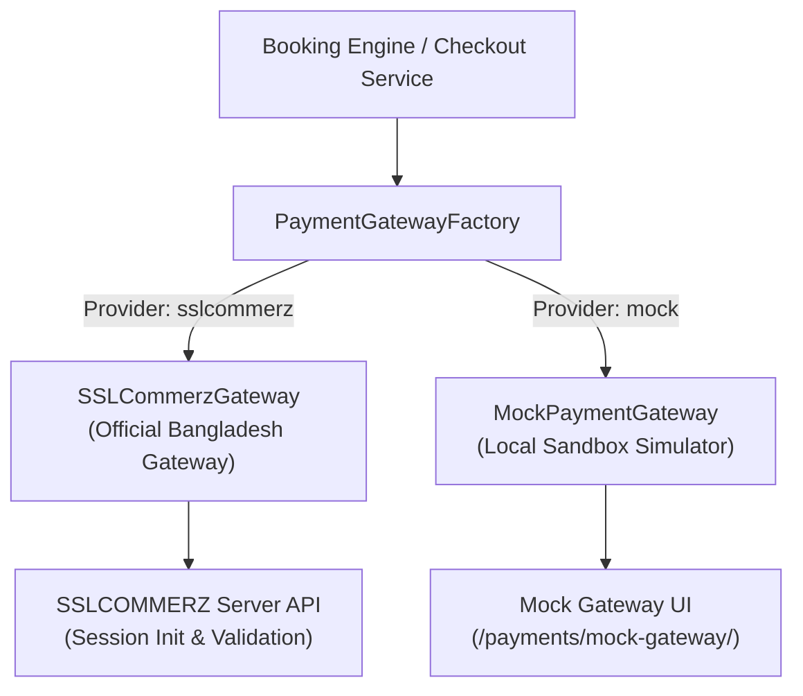

# Green Hospital Payment Gateway & Financial Architecture

Green Hospital implements a decoupled, secure, and PCI-DSS compliant financial subsystem supporting both **Online Gateway Payments (SSLCOMMERZ)** and in-person **Pay at Chamber** collections in Bangladeshi Taka (BDT).

---

## 1. Architecture & Gateway Abstraction

The payment layer is decoupled behind an extensible gateway interface:

### Core Classes (`payments/gateways/`):
- `PaymentGatewayInterface`: Abstract contract defining `initiate_payment()`, `verify_payment()`, `initiate_refund()`, and `query_transaction()`.
- `SSLCommerzGateway`: Implements SSLCOMMERZ V4 REST API using sandbox and live endpoints.
- `MockPaymentGateway`: Safe offline development simulator. Never contacts external servers.

---

## 2. Online Payment Lifecycle & Security Controls

### 2.1 Checkout Session Initiation & Expiration
1. The patient selects **Online Payment** during booking.
2. The server creates an initial `PaymentTransaction` record with status `PENDING` bound strictly to the appointment's authoritative server fee snapshot (`fee_amount`).
3. **15-Minute Expiration Window:** To prevent patients from holding appointment slot capacity indefinitely without paying, sessions expire in 15 minutes (`PAYMENT_CHECKOUT_TIMEOUT_MINUTES=15`).
4. Abandoned sessions are automatically swept by `expire_abandoned_online_sessions()`, releasing the slot back to the public pool.

### 2.2 Server-Side Response Verification (No Frontend Trust)
1. After completing checkout on the gateway, the user is redirected to the hospital callback URL.
2. **The system NEVER marks a transaction successful based on frontend redirect parameters alone.**
3. The server takes the gateway's `val_id` (Validation ID) and queries the gateway's authoritative validation endpoint:
   `https://sandbox.sslcommerz.com/validator/api/validationserverAPI.php`
4. The server validates that:
   - Gateway status is `VALID` or `VALIDATED`.
   - The returned currency is `BDT`.
   - The returned amount matches the internal transaction amount **exactly**.
   - The transaction has not been previously credited.

### 2.3 Amount Tampering & Underpayment Defense
If an attacker attempts to alter the POST payload or pay less than the billed consultation fee:
- The callback is immediately rejected.
- The transaction status is transitioned to `FAILED`.
- A high-priority `SECURITY_ALERT` is recorded in `AuditLog`.
- The appointment remains `UNPAID` and `PENDING`.

### 2.4 Idempotency & Webhook / IPN Handling
- Payment processing is wrapped in `transaction.atomic()` with exclusive row locking (`select_for_update()`).
- Multiple callbacks or Instant Payment Notifications (IPNs) with the same transaction ID are processed idempotently: the second call returns the existing transaction and receipt without double-crediting or creating duplicate receipts.

### 2.5 Zero Card Data Retention
In strict compliance with PCI-DSS:
- No raw credit card numbers, CVVs, or bank PINs ever pass through or are stored in Green Hospital databases.
- Only non-sensitive metadata (card type, masked bin e.g. `VISA-XXXX`, bank transaction ID) is persisted.

---

## 3. Pay at Chamber Workflow

1. **Booking:** Patient selects **Pay at Chamber**. The appointment is confirmed immediately with payment status `UNPAID`.
2. **Front-Desk Collection:**
   - The patient presents their Serial Number or Appointment Reference to reception.
   - The receptionist confirms patient identity and opens the chamber collection interface.
3. **Authorization Enforcement:**
   - Only assigned receptionists (linked via `ReceptionistDoctorAssignment`) or Staff Admins can collect payment.
   - Unassigned staff receive `PermissionDenied`.
4. **Collection Recording:**
   - The receptionist selects the method: `cash` or `pos` (Card Swipe machine at reception).
   - The collected amount is validated to match the appointment fee snapshot.
   - The transaction records: `collected_by`, timestamp, method, amount, and generates an official `Receipt`.
5. **Duplicate Collection Guard:** Attempting to record payment on an already-paid appointment raises `ValidationError("Payment has already been collected for this appointment.")`.

---

## 4. Receipts & Audit Trail

Every successful payment (Online or Chamber) automatically generates an immutable `Receipt`:
- **Unique Receipt Number:** e.g. `REC-20261109-7A8B9C`.
- **Complete Financial Snapshot:** Patient name, Doctor name, BMDC registration number, Billed consultation fee, Amount collected in BDT, Payment method, and Gateway/Voucher reference.
- **Access Control:** Receipts can be viewed and downloaded as PDF/print format by the patient, the consulting doctor, and authorized administrative staff.

---

## 5. Local Mock Gateway for Development

When `PAYMENT_GATEWAY_PROVIDER=mock`:
- Checkout redirects to `/payments/mock-gateway/?tran_id=...`.
- Developers can click:
  - **Simulate Success:** Verifies full payment, issues receipt, and confirms appointment.
  - **Simulate Failure:** Simulates bank rejection, marks transaction `FAILED`.
  - **Simulate Cancel:** Simulates user cancellation.
  - **Simulate Tamper:** Tests amount tampering rejection.
- Zero network requests are made; no live money is processed.
